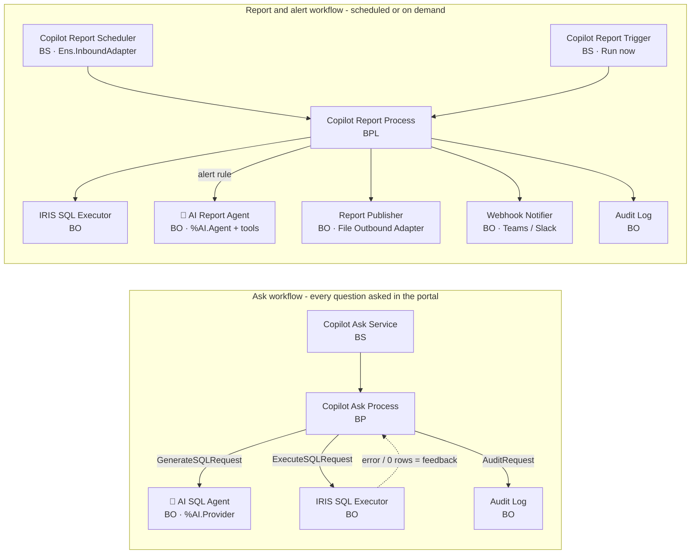
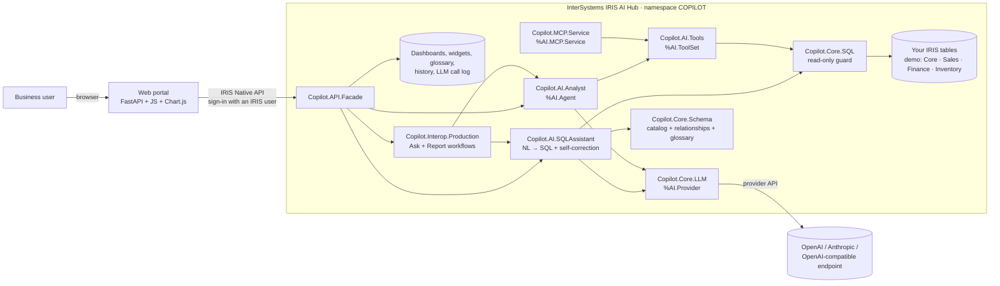

# IRIS Data Copilot

**Ask your InterSystems IRIS data questions in plain English (or Portuguese) - no SQL required.**

Business users struggle with the IRIS Management Portal and IRIS SQL. IRIS Data Copilot is a simple web portal where
people type what they want to know ("revenue by region over the last 6 months") and an LLM managed by
**InterSystems IRIS AI Hub** reads the database catalog, writes the SQL with the right JOINs, runs it on IRIS, fixes
its own mistakes and picks the best chart. With one click the result becomes a **real-time dashboard widget** or a
reusable **SQL view** that any tool (ODBC/JDBC, BI, Excel) can query.

- [Features](#features)
- [AI agents in interoperability workflows](#ai-agents-in-interoperability-workflows)
- [Architecture](#architecture)
- [Step by step: run it on your machine](#step-by-step-run-it-on-your-machine)
- [Step by step: connect your own database](#step-by-step-connect-your-own-database)
- [Configuration reference](#configuration-reference)
- [Languages](#languages-english-and-portuguese)
- [Security](#security)
- [Troubleshooting](#troubleshooting)
- [Project structure](#project-structure)

## Features

| Area | What it does |
| --- | --- |
| **Interoperability workflows** | An IRIS Interoperability production where the AI agents are workflow steps: every question flows through an Ask workflow (AI SQL Agent ⇄ IRIS SQL Executor self-correction loop), and scheduled reports/alerts flow through a BPL workflow (data → alert rule → AI Report Agent → file + webhook). A **Workflows** page shows the production, schedules, reports and a message trace viewer. |
| **Ask - SQL Query** | Natural language → IRIS SQL → execution → chart/table. Multi-turn ("now only the West region", "split by channel"). Self-correction: when IRIS returns an error or 0 rows, the real error goes back to the LLM, which fixes the query (up to 3 attempts). |
| **Ask - AI Analyst** | Autonomous `%AI.Agent` with tools (`%AI.ToolSet`): lists schemas, describes tables, runs queries, cross-checks results and writes an analysis. The queries the agent ran can be opened as charts. |
| **Result actions** | Add to dashboard · Create view · Analyze result (AI executive summary) · Refine with AI · CSV export · Open in the SQL editor. |
| **Dashboards** | Grid of widgets (KPI, bar, line, area, pie, doughnut, scatter, table) with auto-refresh (5 s to 5 min). **✨ Generate with AI**: describe the dashboard and the AI creates 5-8 widgets, testing and fixing every query on IRIS. |
| **SQL editor** | For people who know SQL: run, **Explain with AI** and **Refine with AI** ("only delivered orders"). |
| **Views** | Views created by the portal in the `Analytics` schema, with definition, author and date. |
| **Catalog + Business glossary** | Schemas, tables, columns, primary keys and automatically detected relationships, plus an editable **business glossary**: official definitions ("revenue", "last month", "average order value"...) that the AI must follow in every question, dashboard and analysis. |
| **History** | Audit trail of questions, generated SQL, attempts, time and errors, with "reopen" and "ask again". |
| **Two languages** | English and Portuguese (Brazil) for the UI and for every AI answer, switchable at any time. |
| **Privacy mode** | `PRIVACY_MODE=1`: no data value is ever sent to the LLM - only the question and metadata. Designed for personal and sensitive data (LGPD, GDPR, HIPAA). |

## AI agents in interoperability workflows

IRIS Data Copilot runs an IRIS Interoperability production, `Copilot.Interop.Production`, in which the AI agents
powered by InterSystems AI Hub are regular workflow components - with queues, message trace, audit and retries.



| Component | Type | What it does |
| --- | --- | --- |
| `Copilot Ask Service` | Business service (adapterless) | Entry point; the portal calls it through `Ens.Director.CreateBusinessService` for every question. |
| `Copilot Ask Process` | Business process | Self-correction loop: sends the question to the AI SQL Agent, validates the SQL with the IRIS SQL Executor and, on an IRIS error or an empty result, sends the feedback back to the agent (up to 3 attempts). Every attempt is a message in the trace. |
| `AI SQL Agent` | Business operation | LLM through AI Hub (`%AI.Provider`): question + catalog + glossary + feedback → IRIS SQL. |
| `IRIS SQL Executor` | Business operation | Read-only guard and execution. In the Ask workflow it only validates (no rows are returned). |
| `Copilot Report Scheduler` | Business service (`Ens.InboundAdapter`, CallInterval 30 s) | Finds report subscriptions that are due and starts a Report workflow for each. |
| `Copilot Report Trigger` | Business service (adapterless) | "Run now" from the portal. |
| `Copilot Report Process` | Business process (**BPL**) | Current data → alert rule (first numeric value vs. thresholds) → AI narrative → publish → notify → audit. |
| `AI Report Agent` | Business operation | Runs the autonomous **`%AI.Agent`** (`Copilot.AI.Analyst` with its `%AI.ToolSet`) to write the report narrative. If the LLM is unavailable the workflow still publishes the data. |
| `Report Publisher` | Business operation (`EnsLib.File.OutboundAdapter`) | Writes each report as Markdown to `/home/irisowner/copilot/reports/` and stores it for the portal. The data table comes from IRIS, never from the LLM. |
| `Webhook Notifier` | Business operation | Optional POST to an external system (Microsoft Teams / Slack incoming webhooks, automation tools). |
| `Audit Log` | Business operation | Records every AI interaction (question, SQL, attempts, rows, time, error, IRIS user). |

**How to see it:**

1. Ask any question in **Ask** → the result card shows a **🔀 session N** badge → click it to open the message
   trace of that question.
2. Open **Workflows**: production status, live message counts per component, scheduled reports (**▶ Run now**),
   generated reports and the message trace of every session.
3. Open the standard **IRIS Management Portal** - served by the `webgateway` container, because the AI Hub images
   ship without a web server - at <http://localhost:52773/csp/sys/UtilHome.csp> (`_SYSTEM` / `SYS`):
   **Interoperability → Configure → Production** shows `Copilot.Interop.Production` with its 11 components, the BPL
   of `Copilot.Interop.Process.ReportProcess` opens in the BPL editor, and **Interoperability → View → Messages**
   opens the Visual Trace of every Ask and Report session.
4. In any result, use **⏰ Schedule report** to create your own subscription (frequency, alert thresholds and an
   optional webhook).

The demo ships with a **"Daily revenue check"** subscription (alert when revenue today is below $50,000) that runs once
at startup, so the Workflows page already has a report and a message trace on the first visit.

**Security in the workflows:** production jobs run under the IRIS service account, so the Ask workflow never returns
rows to the user: the catalog is built in the signed-in user's own process (listing only what that user may see) and
the validated SQL is executed again as that user before any data is shown. Report subscriptions are validated as their
owner when created. If the production is stopped, the portal falls back to a direct call and keeps working. Users
other than `_SYSTEM` need an Interoperability role (e.g. `%EnsRole_Operator`) to trigger the workflows.

## Architecture



- **All the intelligence runs inside IRIS.** The web portal is thin: it signs users in and forwards actions to
  `Copilot.API.Facade.Dispatch(action, json)`.
- **LLM governed by AI Hub:** provider, model and key live in IRIS (`%AI.Provider`), never in the browser. Every call
  is logged in `Copilot_Data.LLMCall` (purpose, model, latency, tokens); today's usage is shown in the sidebar.
- **Context that makes the LLM get the JOINs right:** `Copilot.Core.Schema` reads `INFORMATION_SCHEMA` and the class
  dictionary and gives the model every table with types, PK, descriptions (`%DESCRIPTION`), relationships
  (`column -> Schema.Table.Column`, from FOREIGN KEYs **and** from object references in persistent classes), sample
  values of low-cardinality columns (so literal filters are right), today's date and the business glossary.
- **IRIS dialect in the prompt:** `TOP` instead of `LIMIT`, `%EXACT` when grouping text, `CAST(... AS DATE)` before
  `TO_CHAR`, IRIS date functions, etc. Whatever slips through is fixed by the self-correction loop using the real IRIS
  error message.
- **Process isolation:** each AI operation runs in its own IRIS process (`Copilot.Core.Isolate`), keeping AI-Core
  calls at the top of the stack (a workaround for behavior observed in the EAP builds).
- **No web gateway needed:** the portal talks to IRIS through the Native API (superserver, port 1972), so it works
  with container images that do not ship the web server.
- **MCP:** the same data tools are exposed to MCP clients at `/mcp/copilot` (`%AI.MCP.Service`).

## Step by step: run it on your machine

### Prerequisites

- Docker Desktop (Windows/macOS) or Docker Engine + Compose v2 (Linux), with ~8 GB of free disk space.
- An InterSystems account with access to the **AI Hub Early Access Program**.
- An LLM API key (OpenAI by default; Anthropic or any OpenAI-compatible endpoint also work).
- Git.

### 1. Get the code

```bash
git clone https://github.com/Andre-Dienes/iris-dashboard-ai.git
cd iris-dashboard-ai
```

### 2. Download and load the IRIS AI Hub image

The `%AI.*` classes only exist in the AI Hub Early Access builds.

1. Open the [Early Access Program portal](https://evaluation.intersystems.com/Eval/early-access/AIHub) and choose the
   **AI Hub** program.
2. Download the container image for your platform (x64 or ARM64) and, if provided, the license key file
   (e.g. `iris-container-x64.key`).
3. Load the image into Docker and note the tag it prints:

```bash
docker load -i iris-community-2027.1.0AI.109.0-docker.tar.gz
```

Output example: `Loaded image: intersystems/iris-community:2027.1.0AI.109.0`.

### 3. Add the license key (if you received one)

Copy the key file into the `keys/` folder of the project:

```bash
cp /path/to/iris-container-x64.key keys/
```

The folder is mounted at `/external/keys` and the container starts IRIS with `-k /external/keys/<file>.key`, exactly
like the official `docker run ... -k /external/keys/iris-container-x64.key` command. `*.key` files are git-ignored.

> Non-Community images without a valid key refuse external connections ("Unable to allocate a license") and the
> portal cannot sign in. EAP keys are temporary: the IRIS log warns `License will expire in N days`.

### 4. Configure

```bash
cp .env.example .env
```

Edit `.env`:

| Variable | Set it to |
| --- | --- |
| `IRIS_IMAGE` | The tag printed by `docker load` in step 2. |
| `LLM_API_KEY` | Your LLM API key. |
| `LLM_PROVIDER` / `LLM_MODEL` | Optional, defaults `openai` / `gpt-4o-mini`. |
| `LLM_AGENT_MODEL` | Optional stronger model for the AI Analyst only (`.env.example` uses `gpt-4o`). |

### 5. Build and start

```bash
docker compose up -d --build
```

The build compiles the classes, creates the demo dataset, the sample dashboard and the glossary (about 2 minutes).
Follow the startup with:

```bash
docker logs -f copilot-iris
```

Wait for `IRIS Data Copilot ready.`

### 6. Open the portal

Go to <http://localhost:8080> and sign in with `_SYSTEM` / `SYS` (demo password of the image).

| Service | Address |
| --- | --- |
| IRIS Data Copilot portal | <http://localhost:8080> |
| API documentation (OpenAPI) | <http://localhost:8080/api/docs> |
| IRIS Management Portal (through the Web Gateway container) | <http://localhost:52773/csp/sys/UtilHome.csp> (`_SYSTEM` / `SYS`) |
| Production configuration | <http://localhost:52773/csp/copilot/EnsPortal.ProductionConfig.zen?PRODUCTION=Copilot.Interop.Production> |
| Message Viewer / Visual Trace | <http://localhost:52773/csp/copilot/EnsPortal.MessageViewer.zen> |
| IRIS superserver | `localhost:1972` (namespace `COPILOT`) |

### 7. Try it

Questions for the demo dataset:

- What was the monthly revenue over the last 12 months?
- What was the average revenue per customer last month?
- Top 10 best-selling products by quantity this year, with their category
- Revenue and average order value by region and sales channel
- Which salespeople hit their monthly target last month?
- Which products are below minimum stock, and at which branches?
- (AI Analyst) Which branch had the highest revenue growth comparing the last 3 months with the previous 3 months?
- (Dashboards → ✨ Generate with AI) Executive sales dashboard: revenue this month, average order value, cancellation
  rate, monthly trend by channel and branch ranking.

### Demo dataset

A fictional US retail chain, created through DDL with foreign keys and English descriptions:

| Schema | Tables |
| --- | --- |
| `Core` | `Branch` (17 stores in 4 US regions), `Salesperson` (~90), `Customer` (3,000), `Category` (12), `Product` (~100) |
| `Sales` | `SalesOrder` (15,000 orders over 24 months, with seasonality and growth), `OrderItem` (~37,000) |
| `Finance` | `Payment` (credit/debit card, digital wallet, bank transfer; approved, declined, refunded) |
| `Inventory` | `StockLevel` (per product and branch, with reorder point) |

A **simulator** (`Copilot.Setup.Simulator`) inserts an order every 5 s (`SIMULATOR_INTERVAL`), decreases stock and
moves order statuses forward, so dashboards show live data.

### Stop / reset

```bash
docker compose down
```

```bash
docker compose up -d --build
```

`down` stops the stack; the demo database lives inside the image, so the next `up` starts from a clean dataset.
Use `--build` after code changes.

## Step by step: connect your own database

The Copilot works on **any tables visible in the IRIS namespace it runs in**. Pick the option that matches where your
data lives.

| Option | Your data is... | Effort |
| --- | --- | --- |
| [A](#option-a-load-your-data-into-the-docker-stack) | CSV files or SQL scripts you can load | Low |
| [B](#option-b-use-the-docker-stack-with-an-empty-database) | Not ready yet; you want an empty install and will create tables yourself | Low |
| [C](#option-c-install-the-copilot-in-an-existing-iris-instance) | Already in an IRIS / IRIS for Health instance | Medium |
| [D](#option-d-data-in-another-database-postgresql-sql-server-oracle-mysql) | In PostgreSQL, SQL Server, Oracle, MySQL... | Medium |

Whatever the option, finish with [Make the AI understand your data](#make-the-ai-understand-your-data).

### Option A: load your data into the Docker stack

1. Start the stack without the demo data (recommended). In `.env`:

   ```ini
   COPILOT_DEMO=0
   SIMULATOR_INTERVAL=0
   ```

   ```bash
   docker compose up -d --build
   ```

   To keep the demo and add your data next to it, skip this step.

2. Create your tables in the `COPILOT` namespace. Open an IRIS SQL shell:

   ```bash
   docker exec -it copilot-iris iris sql IRIS -U COPILOT
   ```

   and run your DDL, using a schema per business area and **declaring primary and foreign keys** (the AI uses them
   to build JOINs):

   ```sql
   CREATE TABLE Clinic.Patient (
     PatientID INTEGER NOT NULL PRIMARY KEY %DESCRIPTION 'Patient code',
     Name VARCHAR(100) %DESCRIPTION 'Full name',
     BirthDate DATE %DESCRIPTION 'Date of birth',
     %DESCRIPTION 'Patients registered in the clinic')

   CREATE TABLE Clinic.Visit (
     VisitID INTEGER NOT NULL PRIMARY KEY,
     PatientID INTEGER NOT NULL %DESCRIPTION 'Patient seen',
     VisitDate TIMESTAMP %DESCRIPTION 'Date and time of the visit',
     Amount NUMERIC(12,2) %DESCRIPTION 'Amount billed in USD',
     CONSTRAINT FK_Visit_Patient FOREIGN KEY (PatientID) REFERENCES Clinic.Patient (PatientID),
     %DESCRIPTION 'Patient visits')
   ```

   Type `quit` to leave the SQL shell.

3. Copy your CSV files into the container and load them with `LOAD DATA`:

   ```bash
   docker cp ./data/patients.csv copilot-iris:/tmp/patients.csv
   ```

   ```bash
   docker exec -it copilot-iris iris sql IRIS -U COPILOT
   ```

   ```sql
   LOAD DATA FROM FILE '/tmp/patients.csv' INTO Clinic.Patient USING {"from":{"file":{"header":true}}}
   ```

   For larger or recurring loads, mount a folder as a volume in `docker-compose.yml` (e.g. `./data:/data:ro`) and
   load from `/data/...`.

4. **Persist your data.** The demo stack keeps the database inside the container, so recreating the container
   discards changes. For real data, either put the DDL and `LOAD DATA` statements in a class method called from
   `iris/iris.script` (so they run at build time), or use IRIS
   [Durable %SYS](https://docs.intersystems.com/irislatest/csp/docbook/DocBook.UI.Page.cls?KEY=ADOCK#ADOCK_iris_durable)
   with a mounted volume.

5. In the portal, open **Catalog → ↻ Reload catalog**: your tables appear and you can start asking questions.

### Option B: use the Docker stack with an empty database

Set `COPILOT_DEMO=0` and `SIMULATOR_INTERVAL=0` in `.env`, run `docker compose up -d --build` and create/load your
tables as in option A, steps 2-5. No demo tables, sample dashboard or glossary terms are created.

If you already built the stack with the demo, you can remove it without rebuilding:

```bash
docker exec -it copilot-iris iris session IRIS -U COPILOT
```

```objectscript
do ##class(Copilot.Setup.Simulator).Stop()
do ##class(Copilot.Setup.DemoData).DropAll()
do ##class(Copilot.Data.Dashboard).%KillExtent(), ##class(Copilot.Data.Widget).%KillExtent()
do ##class(Copilot.Data.Glossary).%KillExtent()
halt
```

### Option C: install the Copilot in an existing IRIS instance

Use this when your data already lives in an IRIS instance (on-premises, cloud or another container). The instance
must be an **AI Hub build** (the `%AI.*` classes are required) and its superserver port (default 1972) must be
reachable from the machine running the portal.

1. Copy the `src/` folder of this repository to the IRIS server (or to a path the IRIS process can read).

2. In an IRIS terminal, switch to the namespace that contains your data and load the classes:

   ```objectscript
   zn "MYAPP"
   do $system.OBJ.LoadDir("/path/to/iris-dashboard-ai/src", "ck", .errors, 1)
   do ##class(Copilot.Setup.Installer).Install()
   ```

   `Install()` loads no demo data; it registers the MCP tools and prints the schemas the Copilot can see. Only the
   `Copilot.*` package (SQL schemas `Copilot_*`) and `^Copilot.*` globals are added to your namespace.

3. Configure the LLM inside that IRIS instance (it does not read the portal's `.env`). Either set environment
   variables for the IRIS process (`LLM_API_KEY`, `LLM_MODEL`...) or store them in the namespace:

   ```objectscript
   do ##class(Copilot.Core.Config).Set("LLM_PROVIDER", "openai")
   do ##class(Copilot.Core.Config).Set("LLM_API_KEY", "<your key>")
   do ##class(Copilot.Core.Config).Set("LLM_MODEL", "gpt-4o-mini")
   do ##class(Copilot.Core.Config).Set("LLM_AGENT_MODEL", "gpt-4o")
   ```

   Keys stored this way live in the `^Copilot.Config` global of that namespace; protect the database accordingly.

4. Make sure the `%Service_Bindings` service is enabled (Management Portal → System Administration → Security →
   Services) and that portal users have SQL privileges on your tables.

5. Run only the web portal, pointing to your instance. In `.env`:

   ```ini
   EXTERNAL_IRIS_HOST=my-iris-server.example.com
   EXTERNAL_IRIS_PORT=1972
   IRIS_NAMESPACE=MYAPP
   ```

   Use `host.docker.internal` as the host when IRIS runs on the same machine as Docker. Then:

   ```bash
   docker compose -f docker-compose.external.yml up -d --build
   ```

6. Open <http://localhost:8080> and sign in with an IRIS user of that instance.

### Option D: data in another database (PostgreSQL, SQL Server, Oracle, MySQL...)

IRIS can expose tables of other databases through **Foreign Tables** (IRIS 2023.1+) or **SQL Gateway linked
tables**, so the Copilot queries them as if they were IRIS tables, without copying the data.

1. Run the stack with option B (or use your own IRIS, option C).
2. Create a JDBC (or ODBC) **SQL Gateway connection** to your database (Management Portal → System Administration →
   Configuration → Connectivity → SQL Gateway Connections), e.g. named `SalesPG`. When the image has no web server,
   use an IRIS instance that has the Management Portal or create the connection programmatically
   (see [SQL Gateway](https://docs.intersystems.com/irislatest/csp/docbook/DocBook.UI.Page.cls?KEY=BSQG)). The JDBC
   driver `.jar` must be available to IRIS.
3. Create a foreign server and foreign tables in the `COPILOT` namespace:

   ```sql
   CREATE FOREIGN SERVER PG.Server FOREIGN DATA WRAPPER JDBC CONNECTION 'SalesPG'
   CREATE FOREIGN TABLE PG.Orders SERVER PG.Server TABLE 'public.orders'
   CREATE FOREIGN TABLE PG.Customers SERVER PG.Server TABLE 'public.customers'
   ```

   See [Foreign Tables](https://docs.intersystems.com/irislatest/csp/docbook/DocBook.UI.Page.cls?KEY=GSQL_foreigntables).
4. Foreign tables have no foreign keys or descriptions in IRIS, so **describe the joins in the glossary** (next
   section), e.g. term "Orders and customers" → "PG.Orders.customer_id = PG.Customers.id".
5. For heavy dashboards, consider copying the data periodically into native IRIS tables (faster, and they can have
   keys and descriptions).

### Make the AI understand your data

These steps matter more than the model you use:

1. **Descriptions.** Add `%DESCRIPTION` to tables and columns (or `///` comments on persistent class properties).
   State units and meaning: *"Net order value in USD (revenue)"*, *"1 = active, 0 = terminated"*.
2. **Keys.** Declare primary and foreign keys (or object references between persistent classes). They become the
   `->` relationships the AI uses for JOINs.
3. **Business glossary.** In **Catalog → 📘 Business glossary**, add the official definition of every metric and
   period your users talk about (what counts as revenue, which statuses to exclude, fiscal calendar, "active
   customer"...), in plain language and/or SQL. Glossary terms take precedence over the AI's assumptions.
4. **Limit the scope.** Set `VISIBLE_SCHEMAS=Sales,Finance` (allow-list) or `HIDDEN_SCHEMAS=Staging,Tmp` in `.env`
   (or with `Copilot.Core.Config.Set(...)` in option C), or let each user pick **Sources** in the top bar. A smaller
   catalog means faster and more accurate answers. Large catalogs are truncated at `MAX_SCHEMA_CHARS`.
5. **Views for complex logic.** Encapsulate complex business rules in SQL views and describe them; the AI will
   prefer querying the view.
6. **Privileges.** Users sign in with their IRIS credentials, so grant each role `SELECT` only on what it may see.
7. **Personal data?** Turn on `PRIVACY_MODE=1` (see [Security](#security)) and hide schemas the AI does not need.

## Configuration reference

Settings are read from `^Copilot.Config(key)` first, then from the environment (`.env` → container), then defaults.
Change them at run time with `do ##class(Copilot.Core.Config).Set("KEY", "value")` in the `COPILOT` namespace.

| Key | Default | Description |
| --- | --- | --- |
| `IRIS_IMAGE` | `intersystems/iris-community:2027.1.0AI.109.0` | AI Hub image tag (build time). |
| `COPILOT_DEMO` | `1` | `1` builds the demo dataset; `0` installs empty (build time). |
| `LLM_PROVIDER` | `openai` | AI Hub provider name (`openai`, `anthropic`, ...). |
| `LLM_MODEL` | `gpt-4o-mini` | Model for SQL generation, explanations, insights and dashboards. |
| `LLM_AGENT_MODEL` | `LLM_MODEL` | Model for the AI Analyst agent (`.env.example` uses `gpt-4o`). |
| `LLM_API_KEY` | | API key (falls back to `OPENAI_API_KEY` / `ANTHROPIC_API_KEY`). |
| `LLM_BASE_URL` | | OpenAI-compatible endpoint (Azure, Ollama, vLLM, LM Studio). |
| `COPILOT_LANG` | `en` | Default answer language when the UI sends none (`en` or `pt`). |
| `PRIVACY_MODE` | `0` | `1` = no data value is sent to the LLM (metadata only). |
| `PRIVACY_MIN_ROWS` | `10` | Privacy mode: minimum result size for numeric statistics to be shared with the AI. |
| `IRIS_NAMESPACE` | `COPILOT` | Namespace the portal connects to. |
| `VISIBLE_SCHEMAS` | | Allow-list of schemas the AI may see (comma separated). |
| `HIDDEN_SCHEMAS` | | Extra schema prefixes to hide (comma separated). |
| `VIEW_SCHEMA` | `Analytics` | Schema where the portal creates views. |
| `MAX_ROWS` | `1000` | Maximum rows returned per query. |
| `MAX_SCHEMA_CHARS` | `40000` | Maximum size of the catalog context sent to the LLM. |
| `SIMULATOR_INTERVAL` | `5` | Seconds between simulated orders (demo only; `0` disables it). |
| `WEB_PORT` / `IRIS_PORT` / `IRIS_WEB_PORT` | `8080` / `1972` / `52773` | Host ports (portal, superserver, Management Portal through the Web Gateway). |
| `WEBGATEWAY_IMAGE` | `containers.intersystems.com/intersystems/webgateway:2026.1` | Web Gateway image (public InterSystems registry). |
| `EXTERNAL_IRIS_HOST` / `EXTERNAL_IRIS_PORT` | `host.docker.internal` / `1972` | IRIS used by `docker-compose.external.yml`. |

## Languages: English and Portuguese

The portal is bilingual (US and Brazil). The **EN | PT-BR** switch is on the sign-in page and in the top bar; the
choice is saved in the browser, and the first visit follows the browser language. The language applies to:

- **UI:** menus, buttons, dialogs, messages and hints (`web/static/i18n.js`).
- **AI:** titles, explanations, suggestions, analyses, widget titles and AI Analyst answers, with column aliases in the
  same language (`AS Revenue` / `AS Faturamento`). The data and catalog can stay in one language: the AI translates
  business terms.
- **Formats:** numbers and dates (`1,234.56` and `10/31/2026` in EN; `1.234,56` and `31/10/2026` in PT-BR) and CSV
  export (comma separated in EN; semicolon and decimal comma in PT-BR, ready for Excel).
- **Errors:** SQL guard, IRIS and sign-in messages.

User-created content (dashboard names, widget titles, glossary terms, views) stays in the language it was written in.
To add a language, add a block to `I18N` in `web/static/i18n.js` and a branch in
`Copilot.Core.Config.LanguageRule()`.

## Security

- Users sign in with **their own IRIS credentials**; every portal session uses connections authenticated as that
  user, so **IRIS SQL privileges keep applying** (whoever cannot read a table cannot read it through the portal).
- `Copilot.Core.SQL.Validate` accepts only **one** `SELECT`/`WITH` statement, without comments and without
  write/DDL keywords outside literals - for AI-generated SQL, the editor and dashboard widgets alike.
- Creating views is the only write operation, always confirmed by the user and restricted to the `Analytics` schema
  (configurable).
- **What the LLM sees.** In the main SQL flow the model receives the question and metadata only (table/column names,
  descriptions, relationships, glossary, today's date and up to 12 sample values of low-cardinality text columns);
  **result rows never leave IRIS**. With privacy mode off, "Analyze result" sends up to 80 rows and the AI Analyst
  sees up to 50 rows per query.
- **Privacy mode (`PRIVACY_MODE=1`)**, set by the administrator, guarantees that **no data value is sent to the LLM**:
  sample values are not collected; "Analyze result" sends only column names, the row count and numeric statistics
  (min, max, average, sum), and none at all for results smaller than `PRIVACY_MIN_ROWS` (default 10) to avoid
  re-identification; the AI Analyst only learns whether a query works and its shape, while the portal runs the final
  query in IRIS and shows the numbers to the user. A "🔒 Privacy mode" badge is shown in the sidebar.
- **Full sovereignty:** point AI Hub to a private or on-premises model with `LLM_BASE_URL` (Ollama, vLLM, Azure
  OpenAI in your tenant) so not even metadata leaves your infrastructure.
- LLM keys live only in `.env` (git-ignored) or in IRIS config; they never reach the browser. License keys live in
  `keys/*.key` (git-ignored).
- This is a local demo: `_SYSTEM/SYS` is the default password of the image, and the Web Gateway connects as
  `CSPSystem/SYS` (`webgateway/CSP.ini`). Do not expose the ports on a public
  network without changing passwords, restricting roles and putting the portal behind HTTPS.

## Troubleshooting

| Symptom | Cause / fix |
| --- | --- |
| Sign-in fails with `Unable to allocate a license` | Non-Community image without a valid key: put the `.key` file in `keys/` and run `docker compose up -d`. Check `docker logs copilot-iris` for `License will expire`. |
| Sign-in fails with `<SSL Error>` | Old Python driver; the portal pins `intersystems-irispython==5.4.0` (rebuild the web image). |
| Sidebar says "LLM not configured" | `LLM_API_KEY` is empty: set it in `.env` and run `docker compose up -d` (recreates the container). |
| Answers use the wrong metric or period | Add or adjust the definition in **Catalog → Business glossary**. |
| Text results in UPPERCASE | IRIS default collation in `GROUP BY`; the prompt asks for `%EXACT(...)`. Ask again or refine. |
| `docker compose up` fails pulling the IRIS image | The AI Hub image is not on a public registry: `docker load` it and set `IRIS_IMAGE` to the printed tag. |
| Management Portal (port 52773) does not open | Check `docker logs copilot-webgateway`; the gateway signs in to IRIS as `CSPSystem` (password set by `iris/iris.script` and `webgateway/CSP.ini`). |
| Port already in use | Change `WEB_PORT` / `IRIS_PORT` / `IRIS_WEB_PORT` in `.env`. |

## Project structure

```text
src/Copilot/
  API/Facade.cls          single entry point (JSON in/out)
  AI/SQLAssistant.cls     NL→SQL, self-correction, explain, refine, insights, dashboard generation
  AI/Analyst.cls          %AI.Agent (AI Analyst)
  AI/Tools.cls            %AI.ToolSet: ListSchemas, ListTables, DescribeTable, RunQuery
  Core/LLM.cls            %AI.Provider + LLM call log
  Core/Schema.cls         catalog, relationships, sample values, today's date + glossary context
  Core/SQL.cls            read-only validation and execution
  Core/Isolate.cls        runs AI operations in an isolated process
  Core/Config.cls         configuration (^Copilot.Config → environment → default) and language rules
  Data/                   Dashboard, Widget, Glossary, QueryLog, LLMCall, Subscription, Report
  MCP/Service.cls         %AI.MCP.Service at /mcp/copilot
  Interop/Production.cls  interoperability production (Ask + Report workflows)
  Interop/Service/        AskService, ReportScheduler (Ens.InboundAdapter), ReportTrigger
  Interop/Process/        AskProcess (self-correction loop), ReportProcess (BPL)
  Interop/Operation/      AISQLAgent, SQLExecutor, AIReportAgent, ReportPublisher (File adapter), WebhookNotifier, AuditLog
  Interop/Msg/            request/response messages
  Interop/Util.cls        production status, sessions and message trace for the portal
  Setup/                  Installer, DemoData, Simulator
web/
  app/main.py             FastAPI: sign-in, sessions, /api/call/{action}
  app/iris_bridge.py      per-user IRIS Native API connection pool
  static/                 index.html, app.js, i18n.js, styles.css
iris/                     Dockerfile, iris.script, entrypoint.sh, dev-load.sh
webgateway/               InterSystems Web Gateway config (Management Portal on port 52773)
keys/                     put your IRIS license key here (git-ignored)
docker-compose.yml        full stack (IRIS + portal)
docker-compose.external.yml  portal only, for an existing IRIS instance
```

### Development loop

With the containers running, `./iris/dev-load.sh` copies `src/` into the container and recompiles the `Copilot`
package; for the portal, run `docker compose up -d --build web`.

### Tested builds

| Build | Result |
| --- | --- |
| `iris:2027.1.0AI.108.0` + license key | Validated end to end: interoperability production (Ask and Report workflows, auto-start, message trace), portal, NL→SQL with self-correction, AI Analyst (`%AI.Agent`), scheduled AI reports and alerts, dashboard generation, views, live dashboard, privacy mode, EN and PT-BR. |
| `irishealth-community:2026.3.0AI.136.0` | Works without a key, including the portal. |
| `iris-community:2027.1.0AI.109.0` | Build named in the AI Hub program instructions (same setup, key in `keys/`); not yet tested here. |

## License

[MIT](LICENSE)
